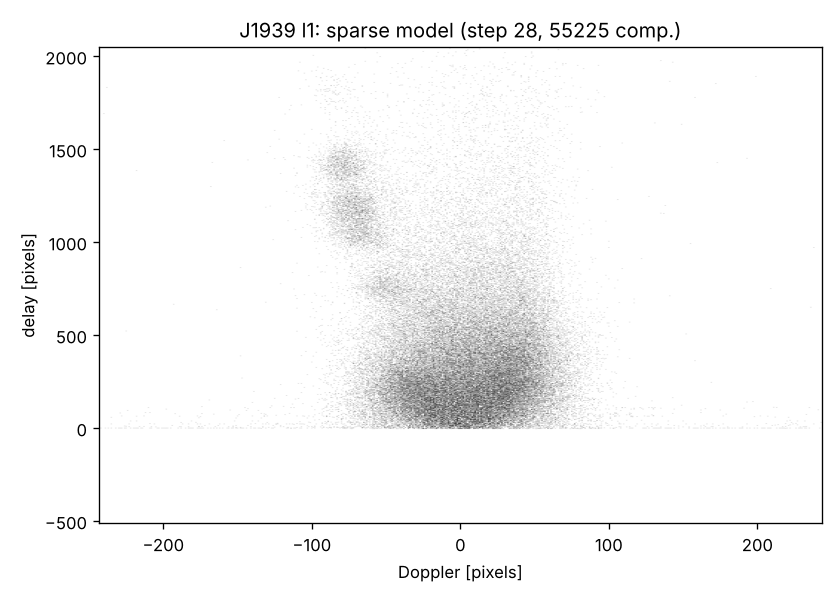
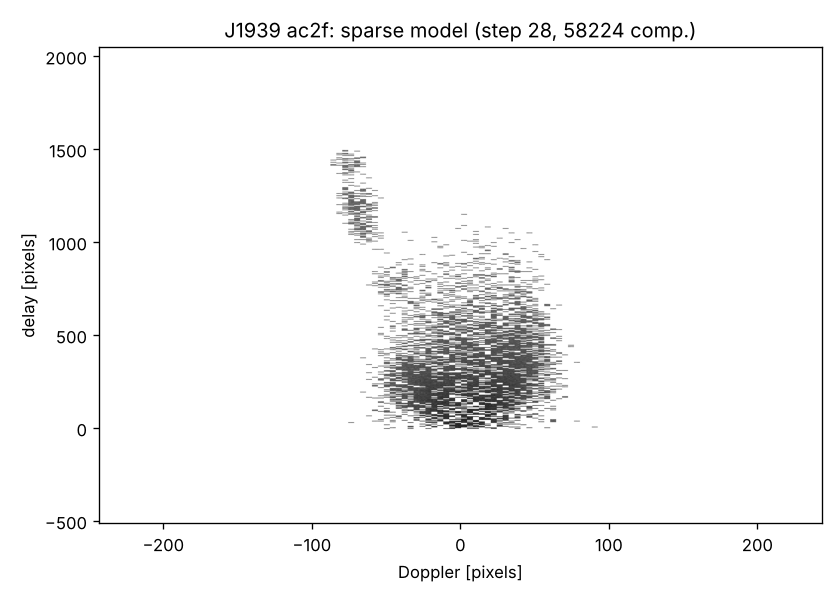
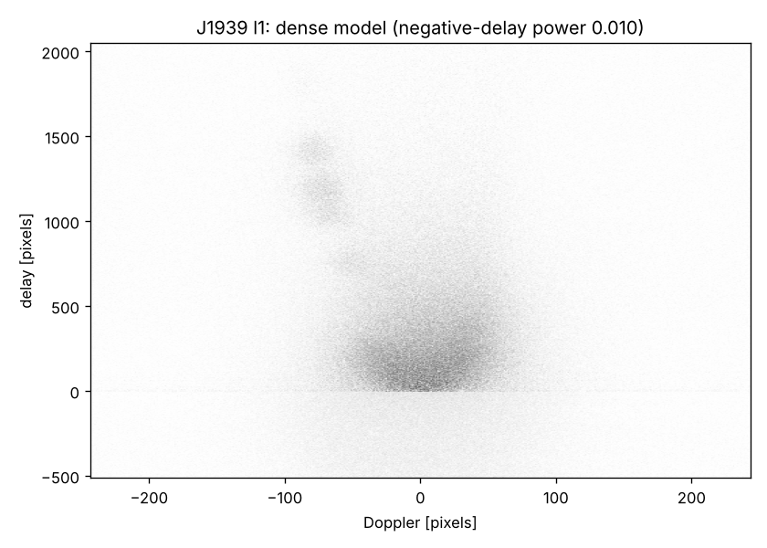
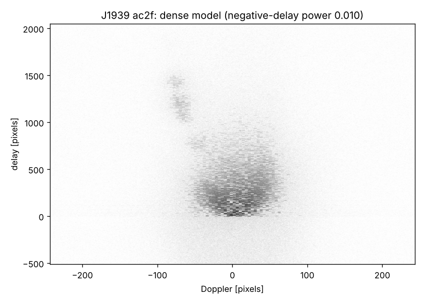

# Dense wavefields: elastic net and coarse-to-fine (block) sparsity

H-FISTA penalises every non-zero pixel. That works when the wavefield is sparse
locally, but fails when it is locally dense (paper §3.1.2, §5.2). This branch tries
the two ideas raised for that: the elastic net (paper §5.4) and estimating the
wavefield at lower resolution and then filling in the corresponding high-resolution
pixels. The second idea is implemented as block (group) sparsity, with block sizes
decreasing over the hierarchy.

Builds on `claude/code-review`. All methods share one H-FISTA loop
(`variants.py`). With `method="l1"` that loop is **bitwise identical** to the
published algorithm (checked on 10 λ steps with and without noise/RFI cleaning), so
the comparisons below are against the real thing.

## Methods (`variants.py`)

| name | penalty | what an "approved" unit is |
|---|---|---|
| `l1` | λ Σ \|h_ij\| (H-FISTA) | a pixel |
| `mcp` γ | minimax concave penalty: firm threshold (zero below λ/L, unshrunk above γλ/L) | a pixel |
| `reweight_passes`, `reweight_c` | l1 re-solved with Λ·ε/(\|h\|+ε), ε = c·λ/L | a pixel |
| `loss="amplitude"` | any of the above, fitting \|ifft2 h\| to √D | – |
| `elastic` β | l1 plus an l2 shrinkage 1/(1+κ), κ = β·λ/λ_init, on penalised pixels | a pixel |
| `group` k | λ k Σ_blocks ‖h_block‖₂ over k×k (Doppler × delay) blocks (group lasso); block soft threshold, block hard threshold | **all allowed pixels of a block**: sparsity between blocks, density within |
| fixed coarse-to-fine | `group` with a block size per λ step, e.g. 4 (8 steps) → 2 (8 steps) → 1 | approval carries over between levels |
| **adaptive coarse-to-fine** (`levels=[4,2,1]`) | stay at a block size until the component count plateaus (≤5% growth between λ steps; leaving the coarsest level also requires the residual to have fallen ≥30% there), then move to the next finer size; stop at the first plateau of the finest level | as above |

The plateau rule uses the signal the paper reports for its successful noise-free case
(the component count stabilises), plus the sharp residual drop that accompanies
twin-image removal.

## Benchmark (`benchmark.py`, `summarize.py`)

256×256 noise-free paper-style simulations (`simulate_regions`): an arc and three
blobs at positive delays, filled at the given local density, plus a strong origin
component. "log-uniform" moduli span 4 decades, like the paper's noise-free 12.5%
wavefield. "uniform" moduli give neighbours of similar strength, the hard case the
paper describes. Similarity is invariant to global phase, translation and the twin
image; solved = > 0.99.

"Stopped" is the model a user would get. The adaptive method uses its own plateau
rule; every other method gets the paper's 3% sparsity criterion, applied after the
fact. "Best" is the best step in hindsight (it needs the truth, so it shows only
potential). The last row runs plain H-FISTA and adaptive coarse-to-fine and keeps the
stopped model with the lower data residual, which needs no truth.

Mean similarity of the stopped model (solved / runs), 6 seeds each:

| method | uniform 12.5% | uniform 25% | log-uniform 25% | log-uniform 50% |
|---|---|---|---|---|
| l1 (H-FISTA) | 0.49 (2/6) | 0.19 (0/6) | **1.00 (6/6)** | 0.64 (2/6) |
| elastic net β=0.5 | 0.36 (1/6) | 0.18 (0/6) | **1.00 (6/6)** | 0.64 (2/6) |
| blocks 4×4 (no refinement) | 0.62 (2/6) | 0.38 (0/6) | 0.89 (4/6) | 0.68 (1/6) |
| fixed 4 → 2 → 1 | 0.38 (1/6) | 0.25 (0/6) | 0.80 (4/6) | 0.31 (0/6) |
| **adaptive 4 → 2 → 1** | **0.69** (2/6) | **0.57** (1/6) | 0.88 (4/6) | **0.80** (1/6; 4/6 > 0.9) |
| **l1 + adaptive, lower residual** | **0.75 (3/6)** | **0.57 (1/6)** | **1.00 (6/6)** | 0.71 (2/6) |

Full tables, including 2-seed runs of elastic net β=0.1, 2×2 blocks and 2×2 → 1, are
in [`results/summary256.md`](results/summary256.md); per-step traces are in
`results/bench256_*.jsonl`.

### What this says

* **Elastic net: no.** It never beats plain l1 here. In the hard regimes it's slightly
  worse (β=0.5), and β=0.1 is indistinguishable from l1. Shrinking all components
  doesn't change *which* components the l1 term selects, and the selection is what
  fails.
* **Coarse-to-fine: yes, partly, and only when adaptive.** Penalising 4×4 blocks
  lets locally dense regions in as units. In the hard regimes the adaptive version
  raises the mean similarity of the model you get, by 1.25–3× (uniform 12.5%:
  0.49 → 0.69; uniform 25%: 0.19 → 0.57; log-uniform 50%: 0.64 → 0.80, with 4 of 6
  seeds above 0.9). Exact recoveries stay rare (1–2 of 6). A *fixed*
  schedule is worse than plain l1, because the switch time matters: it switches before
  the coarse structure has been found. Blocks without refinement find good solutions
  (best-step mean up to 0.81) but then flood the model with blocks, so the stopped
  model is unreliable.
* **Cost on easy cases.** Where l1 already succeeds (log-uniform 25%), block methods
  miss 2 of 6 seeds (stopping at 0.37–0.41 and 0.90). I haven't established why; one
  plausible cause is that a coarse block approves wrong pixels together with right ones
  early on, and they are never removed.
* **Running both and keeping the better fit** recovers l1's 6/6 on easy cases and is
  the best option on uniform 12.5%. The residual is a biased selector, though: on
  log-uniform 50% it sometimes prefers a denser wrong l1 model (seed 2: picks 0.32 over
  0.90).
* **Not yet exact.** When the adaptive method succeeds at the coarse level it often
  stops at ~0.93–0.98 rather than 1. Pixels approved as part of a block stay approved,
  so the model never thins down to the true support. A re-sparsification step at each
  level switch (re-penalising approved pixels whose value is small) is the obvious
  next thing to try.

## Non-convex and reweighted penalties, amplitude loss

Same benchmark, same 6 seeds. All are drop-in changes to the l1 loop:

* **MCP γ=3**: the prox becomes a firm threshold. Values below λ/L go to zero,
  values above 3λ/L are left unshrunk, and values in between scale linearly. Cost is
  unchanged.
* **Reweighted l1**: after each λ step's regularised FISTA, it is re-solved twice with
  Λ scaled by ε/(|h|+ε), ε = c·λ/L. This is the majorise-minimise scheme for the log
  penalty (Candès, Wakin & Boyd 2008). It is about 1.7× slower.
* **Amplitude loss**: fit |ifft2 h| to √D instead of |ifft2 h|² to D. It is a different
  loss, but the λ schedule, stopping rule and debias step are unchanged.

Mean similarity of the stopped model (solved / runs), using the paper's 3% sparsity
criterion:

| method | uniform 12.5% | uniform 25% | log-uniform 25% | log-uniform 50% |
|---|---|---|---|---|
| l1 (H-FISTA) | 0.49 (2/6) | 0.19 (0/6) | 1.00 (6/6) | 0.64 (2/6) |
| **MCP γ=3** | **0.75 (4/6)** | 0.20 (0/6) | **1.00 (6/6)** | **0.87 (4/6)** |
| reweighted l1, c=1 | 0.49 (2/6) | 0.19 (0/6) | 0.99 (5/6) | 0.75 (3/6) |
| reweighted l1, c=4 | 0.49 (2/6) | 0.19 (0/6) | 1.00 (6/6) | 0.64 (2/6) |
| amplitude loss | 0.25 (0/6) | 0.18 (0/6) | 0.90 (5/6) | 0.30 (0/6) |
| amplitude loss + reweighted l1 | 0.25 (0/6) | 0.17 (0/6) | 1.00 (6/6) | 0.30 (0/6) |
| adaptive 4 → 2 → 1 (above) | 0.69 (2/6) | **0.57 (1/6)** | 0.88 (4/6) | 0.80 (1/6) |
| **MCP + adaptive, lower residual** | **0.76 (4/6)** | **0.57 (1/6)** | **1.00 (6/6)** | **0.89 (4/6)** |

* **MCP is the best single change found on this branch.** It doubles the exact
  recoveries in two hard regimes (2 → 4 of 6 each) and solves every easy case. No seed gets
  worse by more than 0.01, and it costs no more than l1. The likely mechanism: l1 shrinks
  strong components as much as weak ones, so the gradient left over after shrinkage
  keeps pulling in wrong pixels. The firm threshold doesn't shrink strong components,
  so that bias is gone.
* **Reweighting is too weak a change.** H-FISTA already sets the penalty of approved
  pixels to zero, which is the extreme form of reweighting. Reweighting within a λ step
  adds little (one extra solved case, log-uniform 50%, c=1).
* **The amplitude loss is worse.** It floods the model with components in the hard
  regimes (≈25k non-zero pixels by step 60). Probably the λ schedule, which is set from
  the intensity-loss gradient, doesn't suit it. I didn't tune it further.
* **MCP and adaptive coarse-to-fine complement each other.** Keeping the lower-residual
  stopped model of the two needs no truth. It has the best mean in every regime.
  Including l1 as a third candidate changes nothing.

Not yet checked: MCP on the paper's 512² data and on J1939. That is the obvious next
run, because MCP alters which components get selected.

### The paper's own failure case (512² noise-free 25%)

Adaptive coarse-to-fine does **not** fix it. The residual declines smoothly
(0.66 → 0.145 over 24 steps) with no sharp drop, as in the published run (0.137 at
step 20, 0.041 at the chosen step 33 with 7583 components). This dataset stays
unsolved.

## Real data: J1939+2134 (`real_data.py`)

Both runs use the notebook configuration (initial RFI mask for the gap, RFI cleaning,
N₀ = 60, the paper's stopping criteria), then the paper's densification (1000
unregularised FISTA iterations).

| | sparse model | sparse residual | dense residual | dense power at negative delays |
|---|---|---|---|---|
| l1 (H-FISTA) | 55 225 pixels at step 28 (sparsity criterion at 29), **identical to the paper** | 0.155 | 1.4e-5 | 0.998% |
| adaptive 4 → 2 → 1 | 58 224 pixels at step 28 (sparsity criterion at 29); **never left the 4×4 level** (no plateau) | 0.171 | 1.1e-5 | 1.000% |

| | l1 (H-FISTA) | adaptive (4×4 blocks) |
|---|---|---|
| sparse |  |  |
| dense |  |  |

The sparse block model is much more compact. A similar number of pixels is confined to
the core, the arc feature at Doppler ≈ −80 / delay 1000–1500 and the bridge between
them, instead of l1's speckle spread over the whole plane (the "fragmented" model of
§5.2). After densification the two are hard to tell apart by the truth-free
diagnostics, and the block version carries a visible 4×4 texture, an imprint of the
block grid rather than of the data. So on J1939 coarse blocks give a cleaner sparse
model, but not a measurably better dense one. The block shape is a free choice:
square 4×4 pixel blocks are very anisotropic here (487 × 4096 pixels), so
physically-shaped blocks are a natural thing to try next.

## Files

* `variants.py`: the shared H-FISTA loop and the regularisers
* `benchmark.py`, `summarize.py`: simulation benchmark (resumable) and tables
* `real_data.py`: observed data with the paper's stopping criteria and densification, plus truth-free diagnostics
* `results/`: benchmark records (`bench256_*.jsonl`), summary, J1939 outputs
