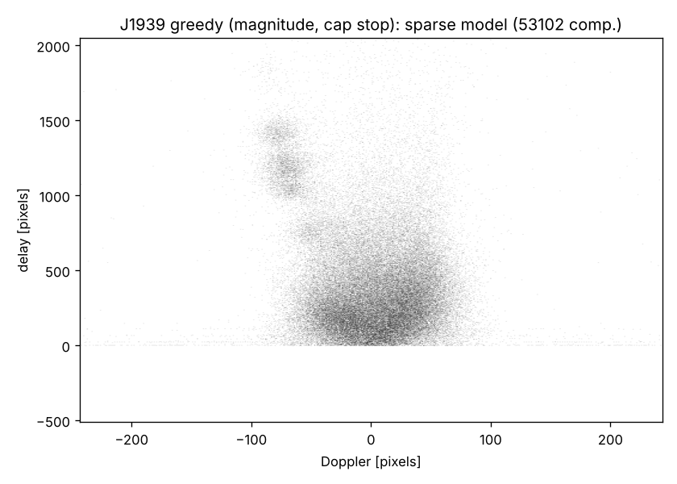
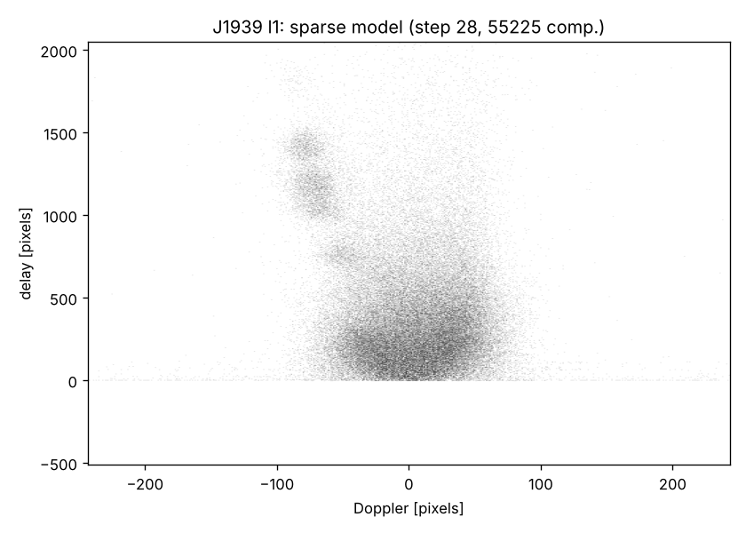
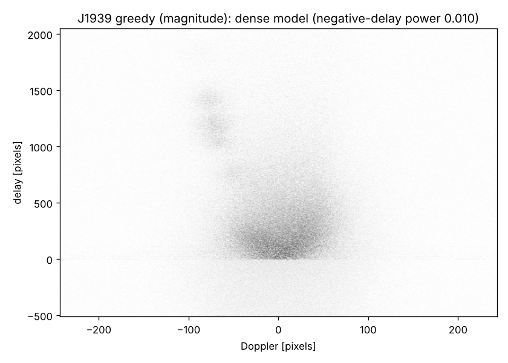
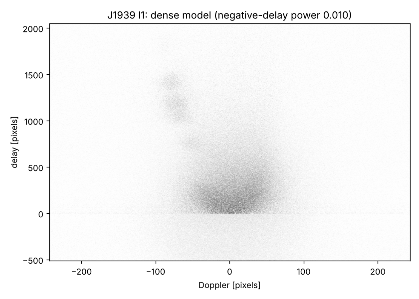

# Greedy sparse phase retrieval: a fast CLEAN

The CLEAN-style method of Walker & Stinebring (2005) and Walker et al. (2008) works on
dynamic spectra, as H-FISTA does. It builds the wavefield one component at a time,
which makes it slow. This branch tests whether a *batched* greedy method can match
H-FISTA at a fraction of the cost. It borrows from two places:

* the major/minor cycles of Clark and Cotton–Schwab CLEAN: pick many components per
  cycle, then refit everything against the data;
* the sparse phase-retrieval literature: GESPAR (Shechtman, Beck & Eldar 2014), and
  the CoSaMP / subspace-pursuit idea of adding more candidates than needed and pruning
  back.

Builds on `claude/dense-wavefields`. The benchmark is the same: 256² noise-free
simulations, the same regimes and seeds, and the same invariant similarity, with
solved = > 0.99.

## Method (`pursuit.py`)

One round:

1. compute the gradient g of H-FISTA's demerit at the current model;
2. add the 2k allowed pixels with the largest |g| outside the support, where
   k = max(4, 0.15·|S|), each starting at the gradient step −g/L;
3. refit all values on the enlarged support: 30 iterations of unpenalised FISTA on
   the support, which is H-FISTA's debias step;
4. **prune**: keep the |S| + k largest |h| (the origin pixel is always kept) and refit.

It starts from the same single origin component as H-FISTA and has no λ and no
threshold schedule. Unlike H-FISTA's approval, step 4 can remove a component found
earlier.

Stopping rules (a residual-plateau rule does not work: the residual barely moves in the
first rounds):

* **noise level (χ²)**: stop when the masked squared residual reaches the noise power,
  estimated from the outer quarter (in both |Doppler| and |delay|) of the secondary
  spectrum, where white noise dominates (`noise_variance`; median-based). On the paper's
  noisy 12.5% simulation the *true* wavefield gives χ² = 0.996, so the estimate is
  accurate there. Noise-free data: stop when the relative residual is < 1e-6.
* **the paper's criteria**: 3% sparsity and the KS test on the Doppler distribution of
  the components new in a round; the answer is the round before the first trigger.
* otherwise the 3% cap.

With RFI cleaning on, the mask is updated after each refit, as in H-FISTA.

## Results (`results/summary256.md`)

| method | uniform 12.5% | uniform 25% | log-uniform 25% | log-uniform 50% | FFTs per run |
|---|---|---|---|---|---|
| H-FISTA (l1) | 0.49 (2/6) | 0.19 (0/6) | **1.00 (6/6)** | 0.64 (2/6) | 32–43k |
| **greedy** | **0.64 (2/6)** | **0.20 (0/6)** | 0.99 (5/6) | **0.75 (3/6)** | **5–7k** |
| greedy, no pruning | 0.49 (2/6) | 0.19 (0/6) | 0.99 (5/6) | 0.75 (3/6) | 2.5–3.5k |
| greedy, growth 0.4 | 0.49 (1/6) | 0.19 (0/6) | 0.99 (5/6) | 0.64 (2/6) | 2.7–3.3k |
| greedy, 8 restarts (jitter 0.3), lowest residual | 0.61 (2/6) | 0.20 (0/6) | **1.00 (6/6)** | **0.76 (4/6)** | 55–93k |

Mean similarity of the stopped model (solved / runs). The l1 FFT counts are measured on
2 seeds per regime. Wall time per run is about 10 s for greedy and 45–65 s for H-FISTA
on this machine.

* **About 6× cheaper than H-FISTA, with equal or better results** in three of four
  regimes. The one loss is a single easy seed (log-uniform 25%, 0.92).
* **Pruning is what makes it better than l1**: without step 4 it's no better than H-FISTA
  on uniform 12.5%. Growing faster (0.4) loses accuracy.
* **Restarts barely help.** Eight randomised runs, keeping the lowest data residual,
  fix the easy-case miss and add one log-uniform 50% case, at 8× the cost.
* **Locally dense uniform-modulus wavefields (uniform 25%) stay unsolved** by every
  method, as with H-FISTA.

## The paper's data (`paper_data.py`, `results/paper/`)

Notebook configuration (masks, RFI cleaning). Cost is FFTs up to the point where each
method stops. H-FISTA is the published loop (`l1_paper_ffts.py`).

| dataset | greedy stop | greedy | H-FISTA | FFTs greedy / H-FISTA |
|---|---|---|---|---|
| simulated 12.5%, noise-free | data fitted (round 29) | **exact** (695 comp.) | exact (647 comp.) | 5.7k / 39k (**6.9× fewer**) |
| simulated 12.5%, noisy | χ² (round 27); the paper's criteria fire at round 29 | **similarity 1.00** (525 comp.; 695 at the paper's stop) | 1.00 (596 comp.) | 5.3k / 21k (**4.0× fewer**) |
| J0837+0610 | χ² (round 44); the paper's criteria at round 40 | 5672 comp.; dense residual 0.070, neg.-delay power 3.1% (3241 comp., 3.3% at the paper's stop) | 4526 comp.; 0.070, 3.2% | 8.9k / 12.9k (1.4× fewer) |
| simulated 25%, noise-free | cap (no rule fires) | sparse residual 0.044 (7502 comp.) | 0.041 (7583; sparsity criterion) | 9.2k / 18.5k (2.0× fewer) |
| J1939+2134 | cap (no rule fires; χ² still 2.3) | 53 102 comp.; sparse residual 0.155, neg.-delay power 0.98% | 55 225 comp.; 0.155, 1.0% | 11.9k FFTs; 25 min vs 46 min wall (both alongside other jobs) |

* **Greedy reproduces H-FISTA's results on the paper's data at a fraction of the cost**:
  both 12.5% simulations are recovered exactly with 4–7× fewer FFTs, and the noise-level
  rule stops it at the right place on the noisy one. On J0837, the 25% simulation and
  J1939 the truth-free diagnostics match H-FISTA's.
* Like H-FISTA it does not solve the 25% simulation.
* On J1939 neither noise rule fires before the 3% cap (χ² = 2.3 at the cap). This matches
  H-FISTA, which also stops by sparsity there. Run alone, greedy took 26 min to the cap.
  The greedy and H-FISTA fields agree at 0.60 (|<E_a, E_b>|/norms over the observed,
  unmasked times). That is the normal spread on J1939 between models that fit the data
  about equally well: MCP vs l1 and padded vs original l1 also give 0.62
  (`claude/dense-wavefields`, dense/README.md).

| | greedy | H-FISTA |
|---|---|---|
| sparse |  |  |
| dense |  |  |

### Pruning with MCP: does not work as implemented

`prune_rule="mcp"` re-solves the enlarged support with the firm threshold, its threshold
set at the |S| + k-th largest |h|. The support collapses to the origin every round:
components near the threshold are shrunk below it in the first iteration, so the FISTA
iterations remove them one after another. Stopped after 32 of 48 runs
(`results/bench256_mcp.jsonl`). A threshold well below the kept set's smallest value
would be needed. Not pursued, because MCP also failed on the paper's data on
`claude/dense-wavefields`.

## Open next steps

* greedy as a cheap first pass, followed by H-FISTA from its support;
* in-repo use: greedy as an optional solver next to H-FISTA, since it reaches the same
  answers on the paper's data at 1.4–7× lower cost.

## Files

* `pursuit.py`: `greedy_pursuit` (with `h_init` to start from a given model, `jitter`/`seed`),
  `restarted_pursuit`, `FFTCounter`
* `benchmark.py`, `summarize.py`; `results/bench256*.jsonl`, `results/l1_ffts.jsonl`, `results/summary256.md`
* `paper_data.py` (with `noise_variance`, `noise_floor_stop`, `paper_stop` in `pursuit.py`), `l1_paper_ffts.py`; `results/paper/`
